> **MOJO:** Welcome to Naman Sharma's profile. Allow me to introduce him. {I would say he needs no introduction, but he did write my script.}

## About Naman

Naman is a third-year Computer Science student at MIT-WPU, Pune (class of 2028). He describes himself as an Indian dev with a hint of "I'm bored", and his motto is *"If it works, don't touch it."* {The motto has been tested extensively, mostly by accident.}

## What he has built

| | |
|---|---|
| 🎙️ **MOJO** | A voice assistant on a locally hosted LLM: wake word, spoken replies, web search and app control. *(private for now)* |
| 🤖 **[OzBot](https://github.com/Naman-D1/OzBot-The-Compact-Security-System)** | A Raspberry Pi doorbell robot. It talks to visitors, sends their photo to the owner on Telegram, and sounds an alarm if a denied visitor stays. Naman led the team. |
| 🧠 **EdgeFlow v2** | A low-compute motion filter for edge cameras that tells people and vehicles from junk motion. |
| 🐝 **H.I.V.E.** | A campus platform for lost & found, supplies sharing and lab booking. *(private repo, in development)* |
| 🔔 **[Ring Ring Run](https://github.com/Digvijay-exe/Ring-Ring-Run)** | A hackathon co-op horror game where a mute leader rings a bell to guide blind teammates. Team of four, from his concept. |
| 🚀 **Astro-Time** | A C++ space-travel simulator across ship types and destinations. |

## What he works with

## Off the clock

Games, hardware tinkering, mechanical keyboards, and hand-drawn animation. I am told this is called a balanced lifestyle.

## Reaching him

I would offer to call him myself, but that feature is still on the roadmap, somewhere behind "stop crashing". Email is the reliable option:

📧 [namansh2005@gmail.com](mailto:namansh2005@gmail.com) · [All repositories →](https://github.com/Naman-D1?tab=repositories)

Introduction delivered by MOJO. No visitors were harmed. Several were mildly impressed.
